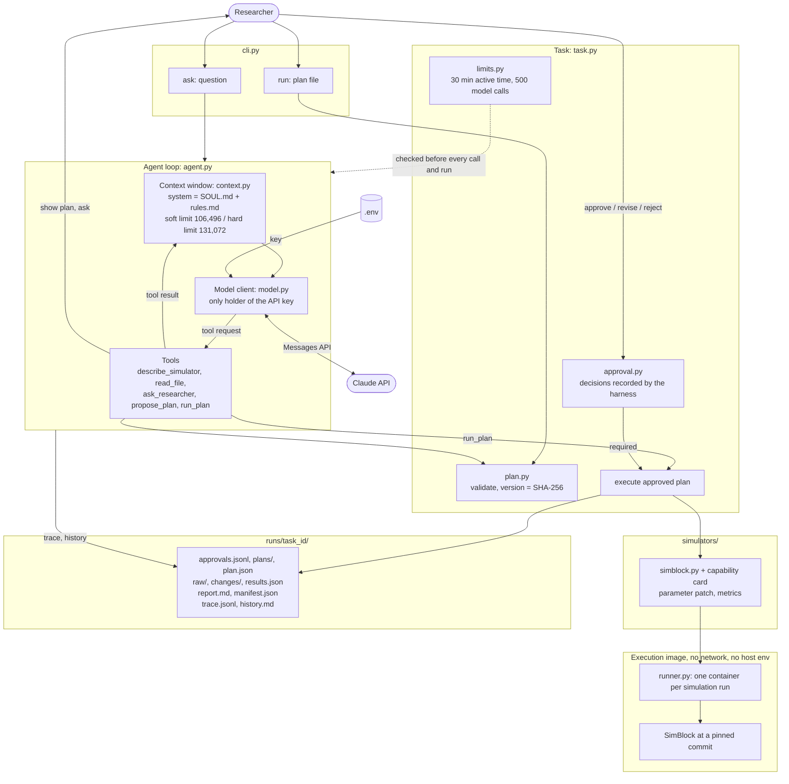

# Architecture

This page describes the system as it is built today and which module holds
each part. The diagram below is the current architecture; keep it true in the
same commit as any change that makes it false. The original long-term sketch
is kept under [Original design sketch](#original-design-sketch).

A module marked _planned_ names where code will go; replace the mark when the
module lands. `task.py` owns a task's artifact directory and executes approved
plans, `report.py` writes the report, and `simulators/base.py` defines the
adapter interface. Each simulator adapter ships a capability card next to it,
for example `simulators/simblock_card.md`.

## Agent tools

The agent has five tools, all defined in `agent.py` as `tool_<name>` methods
with their schemas in `TOOLS`: `describe_simulator`, `read_file`,
`ask_researcher`, `propose_plan`, and `run_plan`. The harness validates every
proposed plan in code before the researcher sees it, records each decision
itself, and refuses `run_plan` for any plan version without a recorded
approval. A rejection ends the task without another model call.

## Data flow

1. The CLI creates a task, its artifact directory, and its trace.
2. The agent loop sends the system prompt, the researcher's request, and the
   conversation to the model.
3. The model requests a tool. The harness checks the request against the
   limits and the approval state, executes it, writes a trace event, and
   returns the result to the model.
4. The model drafts a plan. The Human Interaction tool shows it to the
   researcher, and the harness records the decision for that plan version.
5. After approval, the runner executes simulation runs in the execution image.
   The report step matches planned runs against completed runs and computes
   metrics from raw output.
6. The loop ends when the model finishes, the researcher rejects the plan, or a
   limit stops the task. The harness writes the report and manifest in every
   case.

## Diagram boxes in the first release

This table maps each box of the [original design sketch](#original-design-sketch)
to what the first release builds.

| Diagram element | First release | Module |
|---|---|---|
| Loop (LLM, tool calls, end-loop guardrails) | Yes. One loop; guardrails enforce the time, call, and context limits. | `agent.py`, `model.py`, `limits.py` |
| Tools: Files | Yes. Reads anywhere in the repository and task; writes only inside the task workspace and permitted files. | `agent.py` (`read_file`, read-only in M2); write tools _planned_ for M5 |
| Tools: Execution (Bash) | Replaced by the runner and sandbox exec, both inside the execution image. No general shell on the host. | `runner.py`; sandbox exec _planned_ for M5 |
| Tools: Web Retrieval | Yes. Sources are listed in the project specification. | _planned_ for M4 |
| Tools: Human Interaction | Yes, for clarification and plan review. The harness, not the model, records approval. | `agent.py` (`ask_researcher`, `propose_plan`), `approval.py`, `cli.py` (terminal prompts) |
| Tools: Custom Tools | Later | |
| Simulators: SimBlock, BlockSim | Yes | `simulators/simblock.py`; `simulators/blocksim.py` _planned_ |
| Simulators: Blockemulator | Later | |
| Literature boxes | Partial. Papers With Code is gone; IEEE Xplore needs its own API key and is optional. | _planned_ for M4 |
| System prompt, user prompt, working memory | Yes. The system prompt is `SOUL.md` followed by `rules.md`; the working memory is the current window. | `prompts/`, `agent.py`, `secrets.py` (API keys from `.env`) |
| SOUL.md, SKILL.md, History.md | SOUL.md and a per-task `history.md` are built; SKILL.md and memory across tasks are later. | `prompts/SOUL.md`, `context.py` |
| Context summarization and token caps | Yes, with the diagram's numbers: soft limit 106,496, hard limit 131,072, output 16,384, summary 8,192. | `context.py`, `agent.py` |
| Draft | Yes. The draft is the structured plan shown for review. | `plan.py` |
| LLM Ops: trace | Yes. One `trace.jsonl` per task and a CLI summary of calls, tokens, latency, and errors. | `trace.py` |
| LLM Ops: LLM-as-a-judge, Diagnose, Gate, Release | Later. Result verification is deterministic. | |

All module paths are relative to `src/abc_harness/`.

## Context management

The agent's input is the system prompt (`prompts/SOUL.md`, then
`prompts/rules.md`), the tool definitions, and the messages of the current
window. `context.py` holds the limits and the pieces below, and `Agent.run`
applies them.

- Before every model call the agent estimates the next input from the last
  reported input tokens, the reply, and the new tool results. Past the soft
  limit (106,496 tokens) it compresses first. An input that would leave less
  than one full reply (16,384 tokens) inside the hard limit (131,072 tokens)
  stops the task with reason `context`.
- Compression asks the model, with `prompts/compact.md` and no tools, for a
  summary of at most 8,192 tokens. The summary call counts toward the
  500-call limit.
- The new window is one user message: the original question, a task-state
  block written from the harness's records (plan versions, decisions,
  clarification answers, run results), the summary, the latest tool results,
  and a pointer to `task/history.md`. Plan versions, decisions, and numbers
  never pass through the summary.
- `history.md` receives every message of every window as it happens, with
  full tool results. A tool result longer than 8,192 tokens is cut in the
  window, and the cut notice points to its full text in `history.md`. The
  agent pages through files with `read_file` `offset` and `limit`.
- Requests mark the system prompt as a cache breakpoint and enable automatic
  caching of the conversation tail.
- The manifest records the SHA-256 of each prompt file and the number of
  context windows.

## Execution environment

- Each simulator has its own image, built from `docker/<simulator>/Dockerfile`
  with `abc-harness image build`. The SimBlock image is a digest-pinned
  `eclipse-temurin:21-jdk` plus the SimBlock source at a pinned commit, checked
  by SHA-256. Each task manifest records the image ID and simulator commit.
- SimBlock reads its parameters from Java constants and hard-codes its random
  seed, so every simulation run gets its own source copy with the planned
  constants and seed written in, and compiles it with `javac` in its container.
  The upstream Gradle wrapper is not used.
- The harness and the model client run on the host. The API key never enters a
  container: the docker CLI receives only an allowlist of Docker variables, and
  containers receive no host variables at all.
- At task start, the harness copies the simulator source from the image into the
  task workspace. Each simulation run's container mounts only that run's
  directory.
- Containers run with `--network none`, CPU and memory limits, and a task label.
  On a timeout or limit, the harness stops and removes every container with that
  label.
- Nothing is installed at runtime. A new dependency means a new image, which
  requires a new plan version and fresh approval.

## Original design sketch

[architecture.png](architecture.png) is the maintainer's first sketch of the
long-term design, drawn before any code existed. It records directions beyond
the MVP, such as LLM Ops evaluation and release gates and memory across tasks.
It is not updated as the code changes: where it differs from this page, this
page is correct, and the table above lists each box's status.
