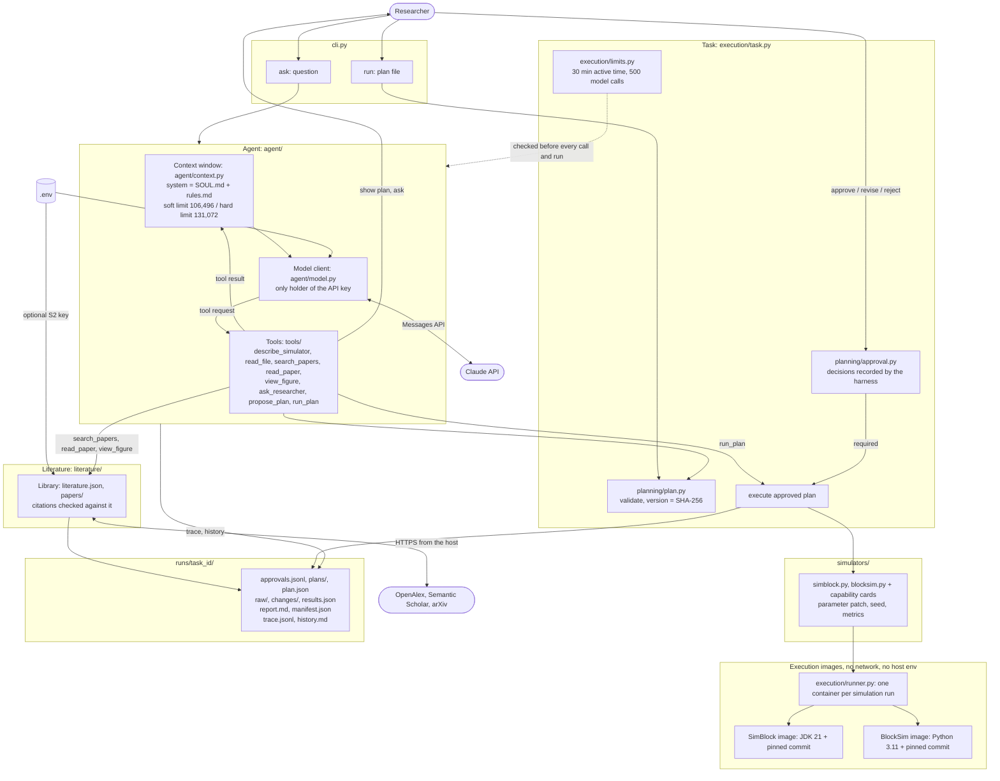

# Architecture

This page describes the system as it is built today and which module holds
each part. The diagram below is the current architecture; keep it true in the
same commit as any change that makes it false. The original long-term sketch
is kept under [Original design sketch](#original-design-sketch).



A module marked _planned_ names where code will go; replace the mark when the
module lands. The [module map](#module-map) says what every file does. Each simulator adapter ships a capability card next to it,
for example `simulators/simblock_card.md` and `simulators/blocksim_card.md`.
The agent reads every card before choosing a simulator and cites entries of
both in the plan's rationale.

## Module map

The package `src/abc_harness/` has one folder per layer; `planning/` and `literature/` share the lowest layer above the simulators. A module imports only
from its own layer or a lower one; `tests/test_rulebook.py` checks this, and it
checks that every module appears in this table.

| Layer (high to low) | File | What it does |
|---|---|---|
| Entry | `cli.py` | Commands `image build`, `run`, `ask`, `trace summary`; shows plans and questions in the terminal. Holds no task logic. |
| Entry | `__init__.py` | Version number and the `abc-harness` entry point. |
| Agent | `agent/loop.py` | The agent loop: call the model, run the requested tools, compress the context at the soft limit. |
| Agent | `agent/model.py` | The Claude API client; the only code that receives the API key. Bounds each call by the remaining time. |
| Agent | `agent/context.py` | Token estimates, `history.md`, and the message that starts a new window. |
| Agent | `agent/secrets.py` | Reads API keys from `.env` and redacts them from traces. |
| Agent | `agent/prompts/` | `SOUL.md` (identity), `rules.md` (workflow), `compact.md` (summary instructions). |
| Tools | `tools/__init__.py` | The explicit list of tools the agent can call. |
| Tools | `tools/base.py` | `ToolContext` (shared task state), `ToolOutput` (a result with images), `ToolError` (refusal), `EndTask` (ends the task). |
| Tools | `tools/describe_simulator.py` | Returns a simulator's capability card. |
| Tools | `tools/search_papers.py` | Searches the first-round venues, or everything when broadened. |
| Tools | `tools/read_paper.py` | Fetches an arXiv paper's full text into `papers/` and returns its outline and figure list. |
| Tools | `tools/view_figure.py` | Shows the model one figure as an image and records that it was viewed. |
| Tools | `tools/read_file.py` | Reads `examples/` and the task's artifact directory, nothing else. |
| Tools | `tools/ask_researcher.py` | Asks the researcher a question; the wait is not active time. |
| Tools | `tools/propose_plan.py` | Validates a plan and its citations, pins the image, and gets the researcher's decision. |
| Tools | `tools/run_plan.py` | Runs an approved plan and summarises the results for the model. |
| Execution | `execution/task.py` | One task end to end: artifact directory, plan versions, image pinning, simulation runs, final artifacts. |
| Execution | `execution/runner.py` | Docker: one container per simulation run, no network, label-based cleanup. |
| Execution | `execution/limits.py` | The 30-minute active time and 500-call limits. |
| Execution | `execution/trace.py` | Writes `trace.jsonl` and summarises it. |
| Execution | `execution/report.py` | Writes `report.md`, `results.json`, and `manifest.json`. |
| Planning | `planning/plan.py` | Plan format, validation, version hash, and the text the researcher reviews. |
| Planning | `planning/approval.py` | Records decisions in `approvals.jsonl` and refuses unapproved versions. |
| Literature | `literature/__init__.py` | The public names of the literature layer. |
| Literature | `literature/library.py` | `Literature` (the services and the Semantic Scholar key) and `Library` (one task's papers, figures, and views in `literature.json`; the quote check). |
| Literature | `literature/openalex.py` | OpenAlex search: request URL and response parsing. |
| Literature | `literature/semantic_scholar.py` | Semantic Scholar search: request URL and response parsing. |
| Literature | `literature/fulltext.py` | Turns arXiv's HTML rendering of a paper into text lines, Markdown tables, an outline, and a figure list. |
| Literature | `literature/figures.py` | The `Figure` record, and an image's format, size, and token cost read from its header. |
| Literature | `literature/papers.py` | The `Paper` record, paper IDs, and the text normalisation used to match quotes. |
| Literature | `literature/http.py` | HTTP requests with per-host pauses and retries that fit the task's remaining time. |
| Simulators | `simulators/__init__.py` | The registry of supported simulators. |
| Simulators | `simulators/base.py` | The interface every simulator adapter implements. |
| Simulators | `simulators/simblock.py` | SimBlock adapter and `simblock_card.md`. |
| Simulators | `simulators/blocksim.py` | BlockSim adapter (Bitcoin model) and `blocksim_card.md`. |

One `ask` passes through the layers in this order:

```
cli.py -> agent/loop.py <-> agent/model.py
            -> tools/propose_plan.py -> planning/plan.py -> execution/task.py (pin image)
               -> cli.py (researcher decides) -> planning/approval.py
            -> tools/run_plan.py -> execution/task.py -> simulators/<name>.py -> execution/runner.py
          -> execution/task.py (close) -> execution/report.py, execution/trace.py
```

## Agent tools

The agent has eight tools, one module each in `tools/`: `describe_simulator`,
`read_file`, `search_papers`, `read_paper`, `view_figure`, `ask_researcher`,
`propose_plan`, and `run_plan`. Each module
holds the definition sent to the model and the harness code that runs it;
`agent/loop.py` keeps only the loop, context compression, and the dispatch by tool
name. The harness validates every
proposed plan in code before the researcher sees it, records each decision
itself, and refuses `run_plan` for any plan version without a recorded
approval. A rejection ends the task without another model call. A plan's
citations pass only if each paper came from `search_papers` in the same task,
and its quote appears verbatim in the paper's abstract or saved full text or
its figure reading names a figure the agent viewed, with an uncertainty.

## Data flow

1. The CLI creates a task, its artifact directory, and its trace.
2. The agent loop sends the system prompt, the researcher's request, and the
   conversation to the model.
3. The model requests a tool. The harness checks the request against the
   limits and the approval state, executes it, writes a trace event, and
   returns the result to the model.
4. When a choice needs evidence, the model searches the literature and reads
   arXiv full texts. The harness performs every request from the host, so the
   execution images stay offline, and records each paper in `literature.json`.
5. The model drafts a plan. The harness checks its citations, pins the execution image's ID into
   it, the Human Interaction tool shows it to the researcher, and the harness
   records the decision for that plan version.
6. After approval, the runner executes simulation runs in exactly that image
   ID, even if the image tag was rebuilt in the meantime.
   The report step matches planned runs against completed runs and computes
   metrics from raw output.
7. The loop ends when the model finishes, the researcher rejects the plan, or a
   limit stops the task. The harness writes the report and manifest in every
   case.

## Diagram boxes in the first release

This table maps each box of the [original design sketch](#original-design-sketch)
to what the first release builds.

| Diagram element | First release | Module |
|---|---|---|
| Loop (LLM, tool calls, end-loop guardrails) | Yes. One loop; guardrails enforce the time, call, and context limits. | `agent/loop.py`, `agent/model.py`, `execution/limits.py` |
| Tools: Files | Yes. Reads anywhere in the repository and task; writes only inside the task workspace and permitted files. | `tools/read_file.py` (read-only); write tools _planned_ for M5 |
| Tools: Execution (Bash) | Replaced by the runner and sandbox exec, both inside the execution image. No general shell on the host. | `execution/runner.py`; sandbox exec _planned_ for M5 |
| Tools: Web Retrieval | Yes, for academic literature only: search and arXiv full text. Sources are listed in the project specification. | `tools/search_papers.py`, `tools/read_paper.py`, `literature/` |
| Tools: Human Interaction | Yes, for clarification and plan review. The harness, not the model, records approval. | `tools/ask_researcher.py`, `tools/propose_plan.py`, `planning/approval.py`, `cli.py` (terminal prompts) |
| Tools: Custom Tools | Later | |
| Simulators: SimBlock, BlockSim | Yes. BlockSim runs its Bitcoin model only. | `simulators/simblock.py`, `simulators/blocksim.py` |
| Simulators: Blockemulator | Later | |
| Literature boxes | Partial. OpenAlex and Semantic Scholar replace DBLP (bot check) and Papers With Code (gone); arXiv serves full text; IEEE Xplore is optional and not built. | `literature/` |
| System prompt, user prompt, working memory | Yes. The system prompt is `SOUL.md` followed by `rules.md`; the working memory is the current window. | `agent/prompts/`, `agent/loop.py`, `agent/secrets.py` (API keys from `.env`) |
| SOUL.md, SKILL.md, History.md | SOUL.md and a per-task `history.md` are built; SKILL.md and memory across tasks are later. | `agent/prompts/SOUL.md`, `agent/context.py` |
| Context summarization and token caps | Yes, with the diagram's numbers: soft limit 106,496, hard limit 131,072, output 16,384, summary 8,192. | `agent/context.py`, `agent/loop.py` |
| Draft | Yes. The draft is the structured plan shown for review. | `planning/plan.py` |
| LLM Ops: trace | Yes. One `trace.jsonl` per task and a CLI summary of calls, tokens, latency, and errors. | `execution/trace.py` |
| LLM Ops: LLM-as-a-judge, Diagnose, Gate, Release | Later. Result verification is deterministic. | |

All module paths are relative to `src/abc_harness/`.

## Context management

The agent's input is the system prompt (`agent/prompts/SOUL.md`, then
`agent/prompts/rules.md`), the tool definitions, and the messages of the current
window. `agent/context.py` holds the limits and the pieces below, and `Agent.run`
applies them.

- Before every model call the agent estimates the next input from the last
  reported input tokens, the reply, and the new tool results. Past the soft
  limit (106,496 tokens) it compresses first. An input that would leave less
  than one full reply (16,384 tokens) inside the hard limit (131,072 tokens)
  stops the task with reason `context`.
- Compression asks the model, with `agent/prompts/compact.md` and no tools, for a
  summary of at most 8,192 tokens. The summary call counts toward the
  500-call limit.
- The new window is one user message: the original question, a task-state
  block written from the harness's records (plan versions, decisions,
  clarification answers, run results), the summary, the latest tool results,
  and a pointer to `task/history.md`. Plan versions, decisions, and numbers
  never pass through the summary.
- `history.md` receives every message of every window as it happens, with
  full tool results. A tool result longer than 8,192 tokens is cut in the
  window, and the cut notice points to its full text in `history.md`. The
  agent pages through files with `read_file` `offset` and `limit`.
- Requests mark the system prompt as a cache breakpoint and enable automatic
  caching of the conversation tail.
- The manifest records the SHA-256 of each prompt file and the number of
  context windows.

## Execution environment

- Each simulator has its own image, built from `docker/<simulator>/Dockerfile`
  with `abc-harness image build`. The SimBlock image is a digest-pinned
  `eclipse-temurin:21-jdk` plus the SimBlock source at a pinned commit, checked
  by SHA-256. Each plan pins the image ID it runs in, and each task manifest
  records that ID and the simulator commit. Rebuilding an image therefore
  changes the version of every new plan.
- SimBlock reads its parameters from Java constants and hard-codes its random
  seed, so every simulation run gets its own source copy with the planned
  constants and seed written in, and compiles it with `javac` in its container.
  The upstream Gradle wrapper is not used.
- The BlockSim image is a digest-pinned `python:3.11-slim` with pandas 1.5.3
  (BlockSim calls `ExcelWriter.save()`, which pandas 2 removed) and the
  BlockSim source at a pinned commit. The adapter selects the Bitcoin model,
  writes planned values into its block of `InputsConfig.py`, forces one
  upstream run per simulation run, and seeds `random` and `numpy.random` in
  `Main.py`. `docker/blocksim/xlsx_to_csv.py` turns BlockSim's Excel result
  into one CSV per sheet so metrics can be recalculated with the standard
  library.
- The harness and the model client run on the host. The API key never enters a
  container: the docker CLI receives only an allowlist of Docker variables, and
  containers receive no host variables at all.
- At task start, the harness copies the simulator source from the image into the
  task workspace. Each simulation run's container mounts only that run's
  directory.
- Containers run with `--network none`, CPU and memory limits, and a task label.
  On a timeout or limit, the harness stops and removes every container with that
  label. If removal fails (for example, the Docker daemon is unreachable), the
  harness records the error in the trace, the manifest, and the report, and
  still writes the results and the final status.
- Nothing is installed at runtime. A new dependency means a new image, which
  requires a new plan version and fresh approval.

## Original design sketch

[architecture.png](architecture.png) is the maintainer's first sketch of the
long-term design, drawn before any code existed. It records directions beyond
the MVP, such as LLM Ops evaluation and release gates and memory across tasks.
It is not updated as the code changes: where it differs from this page, this
page is correct, and the table above lists each box's status.
